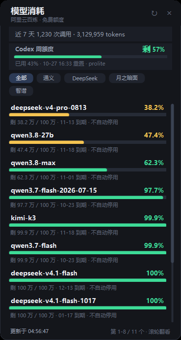

# 百炼 / Codex 额度桌面小组件

[](https://github.com/Charlie500/model-usage-widget/actions/workflows/ci.yml)
[](LICENSE)
[]()
[]()

Windows 桌面小挂件：常驻显示**阿里云百炼各模型免费额度**与**Codex 额度**，剩余快耗尽时弹 Windows 通知。

无 Electron、无第三方依赖 —— 纯 PowerShell 5.1 + WinForms，启动即用。

> 非官方个人项目，与阿里云、OpenAI 无关联，不代表官方立场。

[English](README.en.md) | 简体中文



*预览图为作者本机示例数据。*

## 从 GitHub 克隆

```powershell
git clone https://github.com/Charlie500/model-usage-widget.git
cd model-usage-widget
powershell -ExecutionPolicy Bypass -File install.ps1 -Run
```

## 安装

```powershell
cd %USERPROFILE%\Documents\ModelUsageWidget
powershell -ExecutionPolicy Bypass -File install.ps1 -Run
```

如需开机自启：

```powershell
powershell -ExecutionPolicy Bypass -File install.ps1 -AutoStart -Run
```

安装器会：生成图标 → 创建桌面快捷方式「百炼模型消耗」→（可选）设置开机自启 → 启动小组件。

> 前提：已安装并登录百炼 CLI（`bl`）。登录过期会自动尝试重新登录；失败时托盘右键 →「重新登录百炼」。

## 使用

- **百炼额度列表**：8 行可视，按剩余百分比升序（越危险越靠上）；用**鼠标滚轮**或**拖动右侧滚动条**翻看全部；滚动条长度反映总量。
- **顶部供应商筛选**：`全部 / 通义 / DeepSeek / 智谱 / 月之暗面 / 百度 / MiniMax / 其他`，只显示该供应商的模型；筛选状态会记住。
- **Codex 卡片**：显示 Codex 当前额度窗口（周额度 / 5 小时额度）、剩余百分比、已用百分比、重置时间与计划类型。
- **近 7 天用量**：摘要条显示调用次数与 token 消耗。
- **拖动**：按住标题区/空白处拖动即可；窗口位置会记住。
- **托盘**：双击显示/隐藏；右键：显示、立即刷新、重新登录百炼、开机自启、退出。
- **详情**：鼠标悬停某一行看剩余/总量/到期；点击某一行打开百炼控制台。
- **通知**：百炼模型剩余 ≤20% 警告、≤8% 告急、耗尽提醒；Codex 剩余 ≤20% / ≤8% 同样提醒。同级通知 12 小时内不重复，恢复后重新允许提醒。

## 配置文件 `config.json`

| 字段 | 默认 | 说明 |
|---|---|---|
| `refreshMinutes` | 10 | 自动刷新间隔（分钟） |
| `types` | `["Text"]` | 百炼模型类型；可加 `Vision`、`Multimodal`、`Audio` |
| `warnPercent` | 20 | 警告阈值（剩余百分比，百炼与 Codex 共用） |
| `criticalPercent` | 8 | 告急阈值 |
| `notifyCooldownHours` | 12 | 同一对象同级提醒冷却（小时） |
| `showRecentUsage` | true | 顶部显示近 7 天调用与 token |
| `autoRelogin` | true | 百炼 console 会话过期时自动重新登录 |
| `reloginCooldownMinutes` | 15 | 自动重登失败后的冷却（分钟） |
| `showCodex` | true | 是否显示 Codex 额度卡片 |

改完配置重启小组件生效。

## 数据来源

| 数据 | 来源 | 说明 |
|---|---|---|
| 百炼免费额度 / 近 7 天用量 | `bl usage summary --output json` | 每轮刷新调用一次，需 console 登录 |
| Codex 额度 | `~/.codex/sessions/**/rollout-*.jsonl` | 读取最近会话里最新的 `rate_limits` 快照，**不访问任何外部接口**；只有用过 Codex 才会更新 |

Codex 快照字段示例：`primary.used_percent`、`window_minutes`（10080 = 周额度，300 = 5 小时）、`resets_at`、`plan_type`、`credits`。

> 注意：百炼 console 会话有有效期，过期后小组件会自动尝试重新登录（浏览器 SSO 有效时无感）；若自动失败，托盘右键手动登录一次即可。

## 文件说明

| 文件 | 作用 |
|---|---|
| `ModelUsageWidget.ps1` | 主程序（界面 / 刷新 / 筛选 / 滚动 / 通知） |
| `start-widget.vbs` | 静默启动器（不闪命令行窗口） |
| `install.ps1` | 安装器（图标、快捷方式、开机自启） |
| `config.json` | 用户配置 |
| `state.json` | 运行时状态（窗口位置、筛选、已提醒记录，可删） |
| `widget.log` | 运行日志（排查问题用，可删） |
| `icon.ico` | 安装时生成 |

## 卸载

1. 托盘右键 → 退出；
2. 删除目录 `%USERPROFILE%\Documents\ModelUsageWidget`；
3. 删除桌面快捷方式「百炼模型消耗」；
4. 若开过自启：删除 `%APPDATA%\Microsoft\Windows\Start Menu\Programs\Startup\ModelUsageWidget.lnk`。

## 开发与 CI

- [`.github/workflows/ci.yml`](.github/workflows/ci.yml)：用 **Windows PowerShell 5.1** 解析全部 `*.ps1`（防编码/语法回归），并运行 **PSScriptAnalyzer**（Error 级失败）。
- [`.github/workflows/release.yml`](.github/workflows/release.yml)：推送 `v*` tag 时自动打包 zip 并创建 GitHub Release。

## 免责声明

- 本项目为个人非官方工具，与阿里云、OpenAI / Codex 官方**无任何关联**，不代表官方立场。
- 百炼数据通过官方 `bl` CLI 读取；Codex 数据仅解析**本机会话日志快照**，不调用、不绕过任何官方接口，也不把任何数据上传到第三方。
- Codex 会话日志的 `rate_limits` 字段并非公开协议，可能随版本变化导致该卡片失效，属于预期风险。
- 软件按 MIT 协议「按原样」提供，不提供任何明示或暗示担保，使用风险自负。
- 文中出现的产品名与商标（阿里云、百炼、Codex 等）归各自所有者，仅用于说明兼容对象。

## 常见问题

- **显示「登录已过期」**：会自动尝试重登；如失败，托盘右键 →「重新登录百炼」，浏览器完成授权后点 `↻`。
- **Codex 卡片显示「未找到 Codex 会话数据」**：说明本机还没有 Codex 会话记录，或用过 Codex 后会话日志尚未落盘；启动一次 Codex 即可。
- **Codex 额度显示的是旧值**：它读取的是最近一次 Codex 运行时的快照，长期不用 Codex 不会变化。
- **通知没弹出来**：Windows「专注助手 / 勿扰模式」会拦截通知；也可能是该对象同级提醒还在冷却期内。
- **想改显示哪些模型**：编辑 `config.json` 的 `types`，例如 `["Text","Multimodal"]` 后重启。
